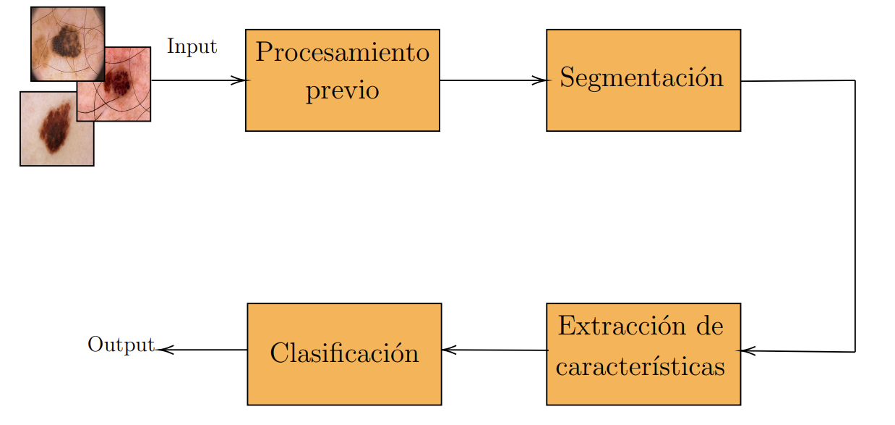
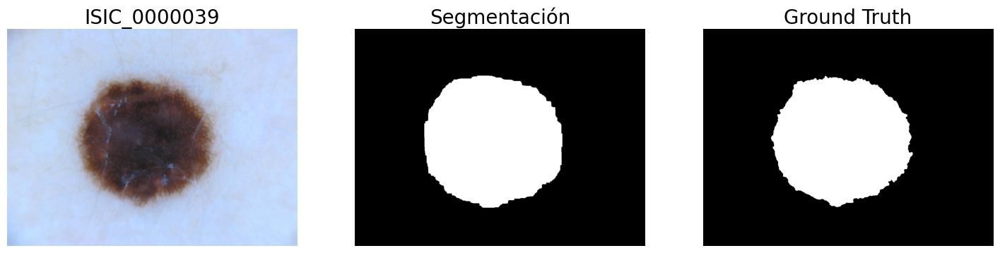
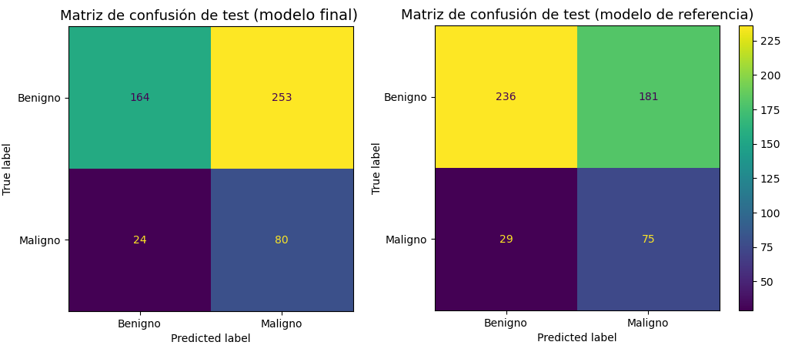

# Melanoma Detection from Dermoscopic Images

A classical computer-vision + machine-learning pipeline that classifies skin lesions as **benign or malignant (melanoma)**. Segmentation and feature extraction are built from well-understood, interpretable techniques (morphological filtering, Otsu thresholding, colour/texture descriptors inspired by the dermatologists' ABCD rule). No deep network is trained, the only learned component is a small tree-based classifier on top of the hand-crafted features.

Final project for *Tratamiento de Imágenes por Computadora* (Image Processing), Facultad de Ingeniería, Universidad de la República (Uruguay), 2023.


<p align="center"></p>

## Pipeline

| Stage | What it does |
|---|---|
| **Preprocessing** | Hair removal with a DullRazor-style filter (black-hat morphology + inpainting). |
| **Segmentation** | Classical, non-learned algorithm: Otsu thresholding, morphological erosion/dilation, and selection of the connected component closest to the image centre. Six parameters tuned by grid search to maximize the Jaccard index. |
| **Features** | Colour moments, histogram descriptors, GLCM texture, LBP, and ABCD-inspired colour markers (black, red, blue-grey, white, …), computed inside the segmented lesion after illumination estimation (grey-edge). |
| **Classification** | Random Forest and XGBoost, tuned with `GridSearchCV`, with decision-threshold selection from precision/recall curves and class weighting to penalize false negatives. |

<p align="center"></p>

## Results

Data: sub-set of the [ISIC 2017](https://challenge.isic-archive.com/data/#2017) challenge (strong class imbalance, melanoma is the minority class) plus a small hand-picked ISIC 2018 subset.

**Segmentation (mean Jaccard index)**

| Train | Validation | Test | ISIC-2018 subset |
|---|---|---|---|
| 0.701 | 0.704 | 0.680 | 0.870 |

**Classification on the test set** (417 benign / 104 malignant), final model vs. a *reference* model trained on features extracted from the ground-truth masks:

| Model | Recall (melanoma) | Precision | False negatives | False positives |
|---|---|---|---|---|
| Final (own segmentation) | 76.9 % (80/104) | 24.0 % | 24 | 253 |
| Reference (ground-truth masks) | 72.1 % (75/104) | 29.3 % | 29 | 181 |

<p align="center"></p>

The thresholds were deliberately set to favour recall, since missing a melanoma is far more costly than a false alarm. The price is a high false-positive rate.
The error analysis traces much of it to a minority of badly segmented images (Jaccard ≈ 0) that inject noise into the features. Promising next steps are CNN-based segmentation and shape/border/symmetry features, which the ABCD rule uses but the current features don't capture.

## Repository structure

```
├── notebooks/            Pipeline notebooks, in execution order
│   ├── 01_train_val_test_split.ipynb      (illustrative: requires the full ISIC-2017 data)
│   ├── 02_preprocessing_hair_removal.ipynb
│   ├── 03_segmentation.ipynb
│   ├── 04_feature_extraction.ipynb
│   └── 05_classification.ipynb
├── src/skin_lesions/     Feature-extraction functions used by the notebooks
├── models/               Trained models (final + reference), loaded with joblib
├── data/
│   ├── features/         Pre-computed feature tables
│   └── Subconjunto_2018/ Extra evaluation images/masks (not tracked, see its README)
├── website/              Source of the project report (Pelican static site, in Spanish)
└── assets/               Images used in this README
```

## Data & attribution

Images come from the ISIC Archive challenges (2017, 2018); please follow their [terms of use and licenses](https://challenge.isic-archive.com/) if you download them.
