Title: Experimentos
Date: 2023-07-03
Category: Page
Ordinal: 004

## Segmentación

Luego de la separación y procesamiento previo, se segmentaron las imágenes con el algoritmo descripto en la sección <em>Métodos</em>. A continuación se presentan los resultados de dicho algoritmo en el conjunto de entrenamiento. Durante los experimentos, se destacan dos situaciones distintas. Por un lado, se tiene el histograma de la figura {#hist1} en el cual se observa un buen desempeño en la mayoria de las imágenes, pero también se nota la presencia de un gran numero de imagenes las cuales no son segmentadas de manera correcta. Por otro lado, cuando se intenta reducir ese número de imágnees mal segmentadas surge el histograma de la figura {#hist2}, en la cual se observa que si bien se logra disminuir la cantidad de segmentaciones fallidas, el índice de Jaccard se ve afectado negativamente, observandose una reduccion en el mismo en comparación con el caso anterior. 

  

    <figure>
      <!-- Incluir camino a la primera imagen a mostrar -->
      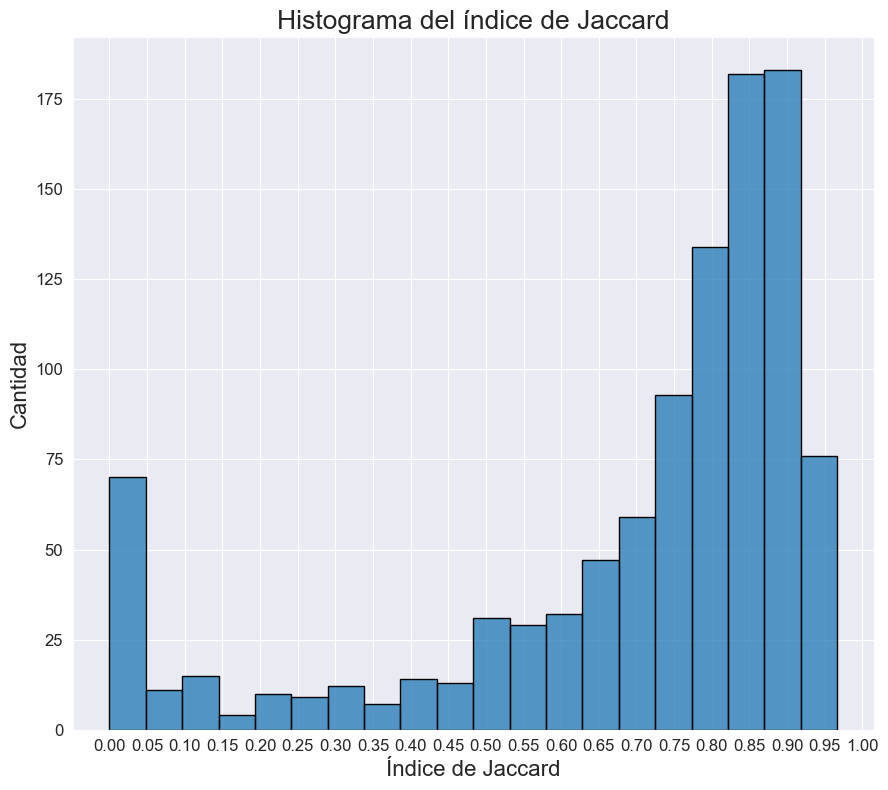
      <figcaption>
        hist1 :: Histograma del índice de Jaccard del conjunto de entrenamiento (caso 1).
      </figcaption>
    </figure>
  

  
  

    <figure>
      <!-- Incluir camino a la segunda imagen a mostrar -->
      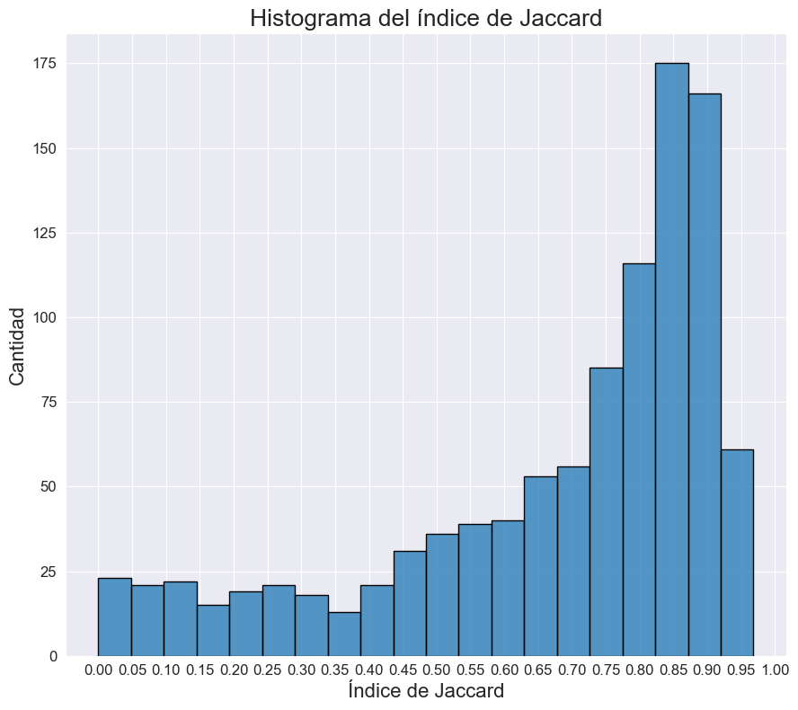
      <figcaption>
        hist2 :: Histograma del índice de Jaccard del conjunto de entrenamiento (caso 2).
      </figcaption>
    </figure>
  

Para el primer caso, se obtuvo un índice de 0.6932 con una desviación estándar de 0.2627. Para el segundo, se obtuvo un índice de 0.6787 con una desviación estándar de 0.2488. Si bien la desviación estándar en el segundo caso es menor que en el primero, el índice de Jaccard tambien se ve reducido. Debido a esto, a continuación se sigue trabajando con el primer caso. Las siguientes imágenes muestran segmentaciones que se consideran exitosas.

  <figure>
    <!-- Incluir camino a la imagen a mostrar -->
    
  </figure>

  <figure>
    <!-- Incluir camino a la imagen a mostrar -->
    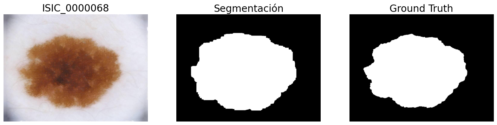
  </figure>

  <figure>
    <!-- Incluir camino a la imagen a mostrar -->
    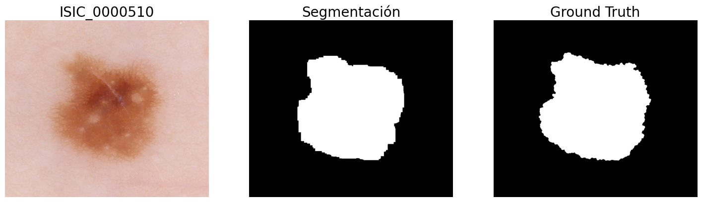
  </figure>

  <figure>
    <!-- Incluir camino a la imagen a mostrar -->
    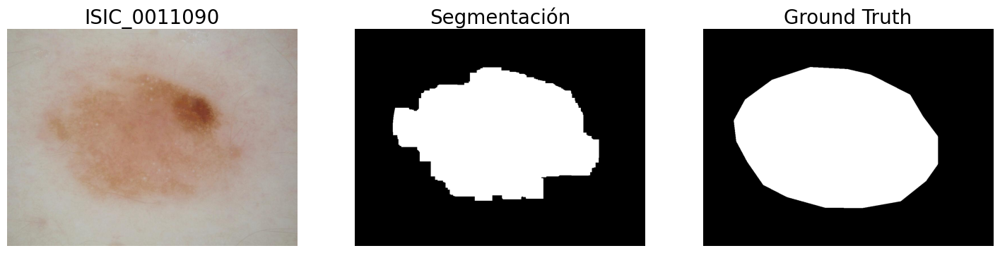
  </figure>

Viendo el histograma de la figura {#hist1}, es claro que hay varios casos donde el algoritmo segmenta de forma incorrecta. Para tener una mayor comprensión de dónde falla el algoritmo, se mostrarán dos casos donde el índice de Jaccard dio cero.

  <figure>
    <!-- Incluir camino a la imagen a mostrar -->
    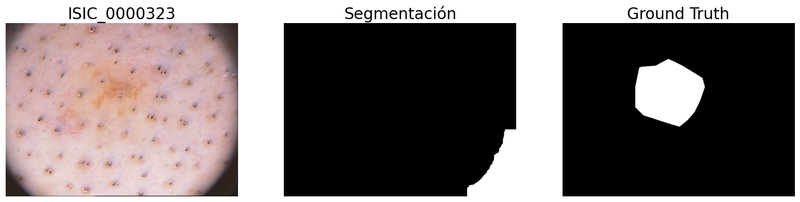
      <figcaption>
        patologico1 :: Caso patológico - Ejemplo 1.
      </figcaption>
  </figure>

  <figure>
    <!-- Incluir camino a la imagen a mostrar -->
    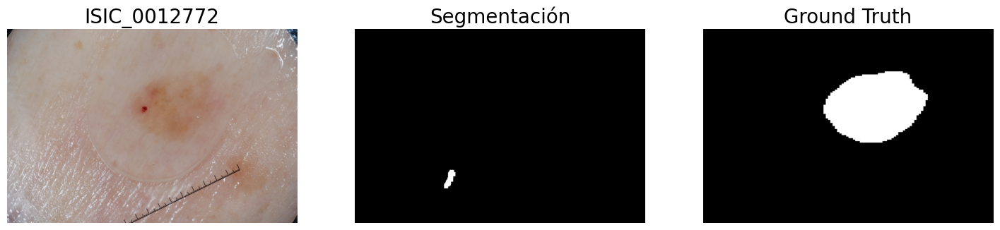
      <figcaption>
        patologico2 :: Caso patológico - Ejemplo 2.
      </figcaption>
  </figure>

En la figura {#patologico1} se observa que el algoritmo falla debido a la presencia del contorno negro dado por el lente de la cámara. En cambio, para la figura {#patologico2}, el algoritmo falla debido al tono de la lesión, el cual es muy similar al color de la piel. 

### Refinamiento de parámetros

Como se habló en la sección de <em>Métodos</em>, el algoritmo tiene ciertos parametros, los cuales se pueden refinar para mejorar el desempeño de la segmentación. Los mismos son: diam_porcentaje, num_er, delta_dil, num_dil, area_component y area_blob. A pesar de haber ajustado los 6 parametros, en esta sección se presentaran únicamente los más influyentes en el desempeño, que son num_er, num_dil y area_blob. Para realizar el refinamiento, se define una lista de posibles valores para cada parámetro, luego se va iterando sobre esta lista y se calcula el índice de Jaccard. Finalmente, se seleccionan los parámetros correspondientes con el mayor índice de Jaccard obtenido. A continuación se ilustra la evolución del índice de Jaccard a medida que varían los parámetros.

  

    <figure>
      <!-- Incluir camino a la primera imagen a mostrar -->
      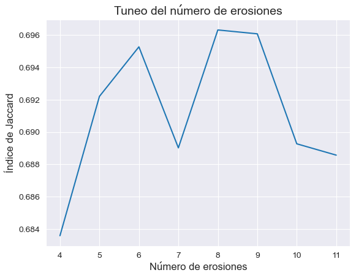
      <figcaption>
        tuneo_dil :: Evolución del índce de Jaccard para distintos valores de num_er.
      </figcaption>
    </figure>
  

  
  

    <figure>
      <!-- Incluir camino a la segunda imagen a mostrar -->
      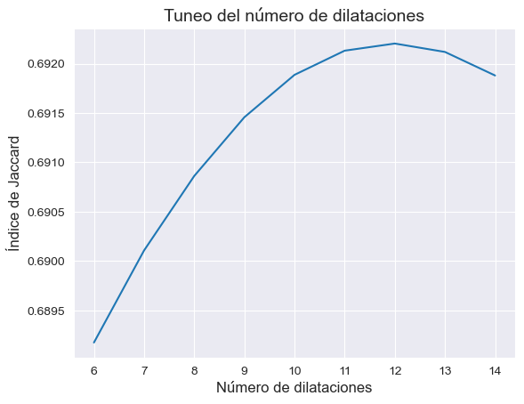
      <figcaption>
        tuneo_er :: Evolución del índce de Jaccard para distintos valores de delta_dil.
      </figcaption>
    </figure>
  

  

    <figure>
      <!-- Incluir camino a la segunda imagen a mostrar -->
      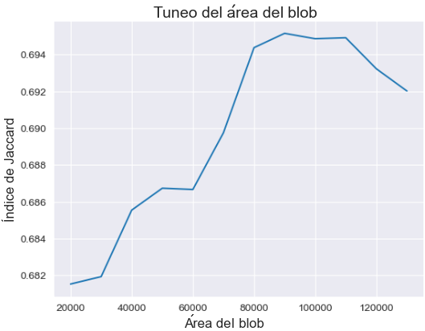
      <figcaption>
        tuneo_blob :: Evolución del índce de Jaccard para distintos valores de area_blob.
      </figcaption>
    </figure>
  

Entonces, los valores que maximizan el índice de Jaccard son: borde = 60, diam_por = 1.45, num_er = 8, delta_dil = 7, num_dil = 12, area_component = 7500 y area_blob = 90000.

### Resultados de la segmentación

Con los párametros ya definidos, se evalúa el algoritmo de segmentación en los subconjuntos de interés. A continuación se presenta una tabla con los resultados relevantes.

  <table border="1">
      <tr>
          <th>Conjunto</th>
          <th>Entrenamiento</th>
          <th>Validación</th>
          <th>Prueba</th>
          <th>Subconjunto de 2018</th>
      </tr>
      <tr>
          <td>Índice de Jaccard promedio</td>
          <td>0.7013</td>
          <td>0.7037</td>
          <td>0.6804</td>
          <td>0.8696</td>
      </tr>
      <tr>
          <td>Desviación estándar</td>
          <td>0.2592</td>
          <td>0.2440</td>
          <td>0.2700</td>
          <td>0.0743</td>
      </tr>
  </table>

<b>Tabla 1:</b> índice de Jaccard medio y desviación estándar para los conjuntos de interés.

<!-- AGREGAR LEYENDA TABLA!!!! -->
<!-- AGREGAR LEYENDA TABLA!!!! -->
<!-- AGREGAR LEYENDA TABLA!!!! -->
<!-- AGREGAR LEYENDA TABLA!!!! -->

Es de interés destacar el desempeño del algoritmo de segmentación en el subconjunto de 2018. La gran diferencia de desempeño se puede deber a que dicho subconjunto no presenta los casos patológicos previamente vistos. En la figura {#hist_sc} se presenta el histograma obtenido al segmentar el subconjunto de 2018. Comparándolo con el obtenido en las figuras {#hist1} y {#hist2}, es claro que este último representa un mejor resultado. Además, en la figura {#his_test} se presenta el histograma obtenido para el conjunto de prueba. Es interesante notar que el mismo es muy similar a los obtenidos para el conjunto de entrenamiento y validación, quitando que hay una menor cantidad de segmentaciones cercanas a un indice de 1.

  

    <figure>
      <!-- Incluir camino a la primera imagen a mostrar -->
      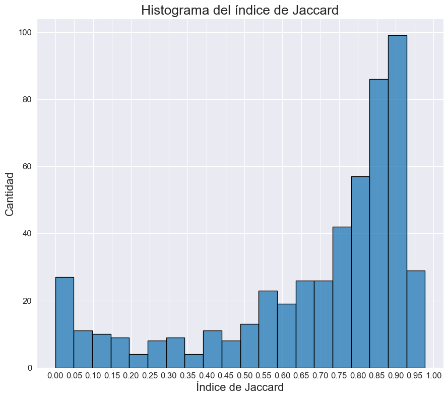
      <figcaption>
        his_test :: Histograma del índice de Jaccard para el conjunto de prueba.
      </figcaption>
    </figure>
  

  
  

    <figure>
      <!-- Incluir camino a la segunda imagen a mostrar -->
      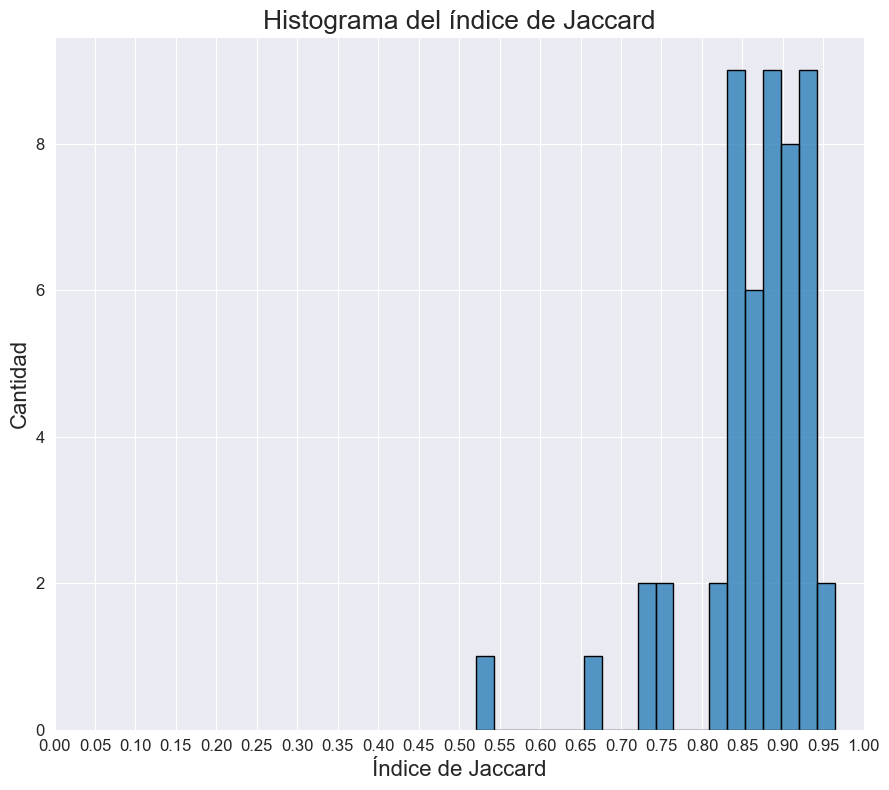
      <figcaption>
        hist_sc :: Histograma del índice de Jaccard para el subconjunto 2018.
      </figcaption>
    </figure>
  

En las siguientes figuras se presentan distintos ejemplos de segmentación, donde se superponen la segmentación obtenida por el algoritmo desarrollado con la segmentación dada por el "ground truth". La región azul está dada por la segmentación del "ground truth", la región verde por la segmentación por el algoritmo y en amarillo se destaca donde ambas segmentaciones se superponen.

  

    <figure>
      <!-- Incluir camino a la primera imagen a mostrar -->
      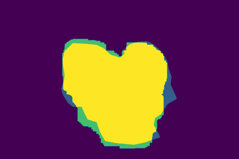
      <figcaption>
        tuneo_dil :: Segmentación dada por el algoritmo superpuesta con el "ground truth".
      </figcaption>
    </figure>
  

  
  

    <figure>
      <!-- Incluir camino a la segunda imagen a mostrar -->
      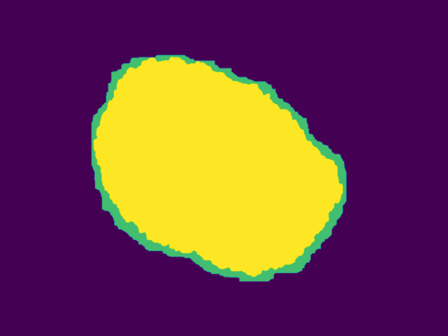
      <figcaption>
        tuneo_er :: Segmentación dada por el algoritmo superpuesta con el "ground truth".
      </figcaption>
    </figure>
  

  
  

    <figure>
      <!-- Incluir camino a la segunda imagen a mostrar -->
      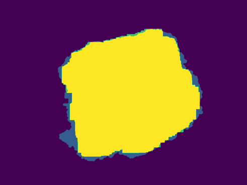
      <figcaption>
        tuneo_blob :: Segmentación dada por el algoritmo superpuesta con el "ground truth".
      </figcaption>
    </figure>
  

## Modelo

Luego de realizada la segmentación, se extraen las características indicadas en <em>Métodos</em>. Dado que el problema se basa en clasificar un elemento dado un conjunto de características numéricas, resultó de interés explorar dos modelos: uno basado en RandomForest y un clasificador XGBoost. Para comenzar, veamos el desempeño del modelo basado en RandomForest.

### RandomForest

En primer lugar, se entrena un RandomForest con una profundidad máxima de 10. En la siguiente tabla se presentan distintas métricas relevantes en los conjuntos de entrenamiento y validación. Es importante tener en cuenta que las clases están desbalanceadas, por lo que analizar solamente la "accuracy" no será suficiente.

  <table border="1">
      <tr>
          <th>Conjunto evaluado</th>
          <th>Precisión</th>
          <th>Recall</th>
          <th>F1-score</th>
          <th>Accuracy</th>
          <th>Kappa</th>
          <th>ROC-AUC</th>
      </tr>
      <tr>
          <td>Entrenamiento</td>
          <td>1.0</td>
          <td>0.7902</td>
          <td>0.8828</td>
          <td>0.9583</td>
          <td>0.8579</td>
          <td>0.8951</td>
      </tr>
      <tr>
          <td>Validación</td>
          <td>0.6250</td>
          <td>0.1389</td>
          <td>0.2272</td>
          <td>0.8142</td>
          <td>0.1677</td>
          <td>0.5592</td>
      </tr>
      <tr>
          <td>Subconjunto 2018</td>
          <td>1.0</td>
          <td>0.6316</td>
          <td>0.7742</td>
          <td>0.8627</td>
          <td>0.6827</td>
          <td>0.8158</td>
        </tr>
  </table>

<b>Tabla 2:</b> RandomForest parámetros por defecto con max_depth = 10.

Observando la tabla, podemos concluir que el modelo se sobreajustó a los datos. Es más, el "Kappa" de validación (el cual es una métrica que tiene en cuenta el desbalance) es significativamente menor. Viendo la matriz de confusión de los datos de validacion, presentada en la figura {#cm_forest_default}, se logra observar el mismo fenómeno: al modelo se le escapan muchas lesiones malignas.

  

    <figure>
      <!-- Incluir camino a la segunda imagen a mostrar -->
    
    <figcaption>
      cm_forest_default:: Matrices de confusión de un RandomForest con profunidad máxima de 10.
    </figcaption>
    </figure>
  

Para intentar mejorar el desempeño del modelo, se ajustó el número de estimadores y la profundidad del modelo utilizando la función GridSearchCV, proporcionada por scikit-learn. Se probó maximizar dos métricas: el "F1-score" y el "ROC-AUC". El "F1-score" combina la precisión y el "recall" en una sola métrica, mientras que "ROC-AUC" intenta medir la tasa de verdaderos positivos y falsos positivos para diferentes umbrales. 

En la siguiente figura se compara el "F1-score" obtenido para ambos casos, en el conjunto de validación. A la izquierda, se maximizó el "F1-score", mientras que a la derecha se maximizó el "ROC-AUC". El "F1-score" máximo en la gráfica de la izquierda es 0.45, mientras que el máximo en la gráfica de la derecha es 0.44. En general, se observo que maximizar cualquiera de las dos métricas arrojaba resultados similares, es por esto que de ahora en mas no se aclarará de forma explícita que métrica se maximizó. En la práctica, se probará maximizar ambas y se tomó el modelo que tenia mejor desempeño.

<!-- NO SE SI APORTA LA ACLARACION: Se observo que a medida que lograbamos mejorar el desempeño del modelo-->
<!-- NO SE SI APORTA LA ACLARACION: Se observo que a medida que lograbamos mejorar el desempeño del modelo-->
<!-- NO SE SI APORTA LA ACLARACION: Se observo que a medida que lograbamos mejorar el desempeño del modelo-->
<!-- NO SE SI APORTA LA ACLARACION: Se observo que a medida que lograbamos mejorar el desempeño del modelo-->

  

    <figure>
      <!-- Incluir camino a la segunda imagen a mostrar -->
    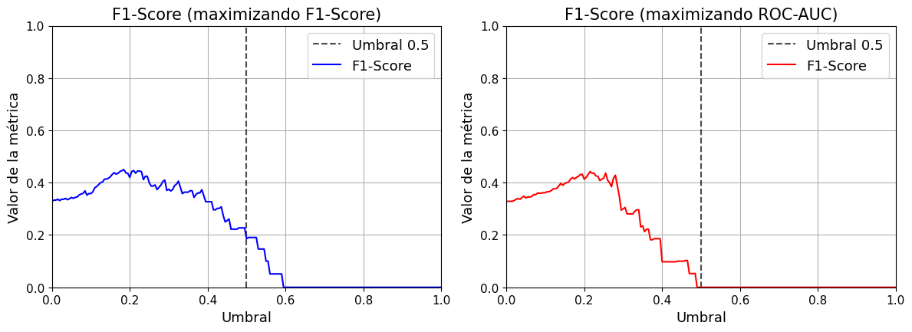
    <figcaption>
      f1_tree:: Valor del "F1-score" en el conjunto de validación para distintos umbrales, dado si maximizo "F1-score" (izquierda) o "ROC-AUC" (derecha) al usar GridSearchCV.
    </figcaption>
    </figure>
  

Tal como se intuye de la figura {#f1_tree}, se puede mejorar el desempeño del modelo moviendo el umbral. Para esto, se grafica la precisión junto al "recall" en función del umbral de decisión, de manera que se pueda elegir el umbral óptimo analizando ambas métricas. En este caso, simplemente se tomó el umbral que maximizaba el "F1-Score". Para este modelo, el umbral es 0.215, obteniendose los siguientes resultados.

  <table border="1">
      <tr>
          <th>Conjunto evaluado</th>
          <th>Precisión</th>
          <th>Recall</th>
          <th>F1-score</th>
          <th>Accuracy</th>
          <th>Kappa</th>
          <th>ROC-AUC</th>
      </tr>
      <tr>
          <td>Entrenamiento</td>
          <td>0.4640</td>
          <td>0.8488</td>
          <td>0.6000</td>
          <td>0.7750</td>
          <td>0.4615</td>
          <td>0.8027</td>
      </tr>
      <tr>
          <td>Validación</td>
          <td>0.3247</td>
          <td>0.6944</td>
          <td>0.4425</td>
          <td>0.6557</td>
          <td>0.2382</td>
          <td>0.6704</td>
      </tr>
          <td>Subconjunto 2018</td>
          <td>0.6207</td>
          <td>0.9474</td>
          <td>0.7500</td>
          <td>0.7647</td>
          <td>0.5453</td>
          <td>0.8018</td>
        </tr>
  </table>

<b>Tabla 3:</b> RandomForest con parámetros refinados y umbral de decisión ajustado.

Comparando los resultados obtenidos, especialmente en cuanto al "recall" y las métricas que consideran el desbalance de datos, se observa una clara mejora. A continuación se muestra la matriz de confusión obtenida en el conjunto de validación. En comparación con el modelo anterior, se pueden apreciar menos falsos negativos, los cuales tienen un impacto más significativo que los falsos positivos. Con respecto al subconjunto correspondiente a 2018, el desempeño del modelo es considerablemente mejor. Incluso sería posible ajustar el umbral aún más hacia la derecha, de manera que el único falso negativo restante sea clasificado como maligno. Sin embargo, se tomó la decisión de no hacerlo debido al aumento en la cantidad de falsos positivos que esto implicaría, lo cual sería costoso.

<!-- FIJARME BIEN SI ACLARO QUE LOS FALSOS NEGATIVOS SON MAS COSTOSOS QUE LOS FALSOS POSTIVIOS ANTES, ES ALGO INTERESANTE A PONER-->
<!-- FIJARME BIEN SI ACLARO QUE LOS FALSOS NEGATIVOS SON MAS COSTOSOS QUE LOS FALSOS POSTIVIOS ANTES, ES ALGO INTERESANTE A PONER-->
<!-- FIJARME BIEN SI ACLARO QUE LOS FALSOS NEGATIVOS SON MAS COSTOSOS QUE LOS FALSOS POSTIVIOS ANTES, ES ALGO INTERESANTE A PONER-->

  

    <figure>
      <!-- Incluir camino a la segunda imagen a mostrar -->
    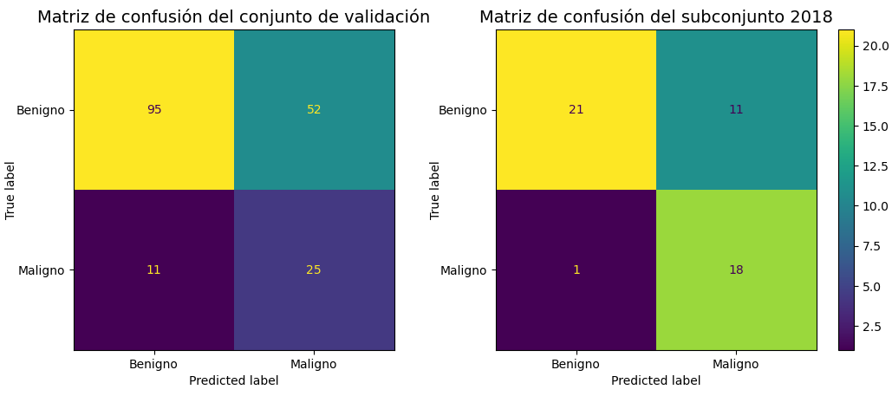
    <figcaption>
      arbol_tuneado:: Matrices de confusión de un RandomForest con los parametros refinados y el umbral ajustado.
    </figcaption>
    </figure>
  

### XGBoost

Para comenzar, se definió un XGBClassifier con una profundidad maxima de 10. El desempeño se ve en la tabla a continuación.

  <table border="1">
      <tr>
          <th>Conjunto evaluado</th>
          <th>Precisión</th>
          <th>Recall</th>
          <th>F1-score</th>
          <th>Accuracy</th>
          <th>Kappa</th>
          <th>ROC-AUC</th>
      </tr>
      <tr>
          <td>Entrenamiento</td>
          <td>1.0</td>
          <td>1.0</td>
          <td>1.0</td>
          <td>1.0</td>
          <td>1.0</td>
          <td>1.0</td>
      </tr>
      <tr>
          <td>Validación</td>
          <td>0.5238</td>
          <td>0.3056</td>
          <td>0.3860</td>
          <td>0.8087</td>
          <td>0.2819</td>
          <td>0.6188</td>
      </tr>
          <td>Subconjunto 2018</td>
          <td>0.8667</td>
          <td>0.6842</td>
          <td>0.7647</td>
          <td>0.8431</td>
          <td>0.6495</td>
          <td>0.8109</td>
        </tr>
  </table>

<b>Tabla 4:</b> XGBClassifier con una profundidad de 10. 

Es importante resaltar el rendimiento destacado del modelo en el subconjunto correspondiente a 2018, donde se observa una clara mejora en comparación con RandomForest. A continuación, se muestran las matrices de confusión tanto para el conjunto de validación como para el subconjunto de 2018. Al comparar con las matrices obtenidas para el mejor modelo basado en RandomForest, es notable que ahora se tiene una cantidad mayor de falsos negativos, pero, por otro lado, se ha logrado reducir la cantidad de falsos positivos.

  

    <figure>
      <!-- Incluir camino a la segunda imagen a mostrar -->
    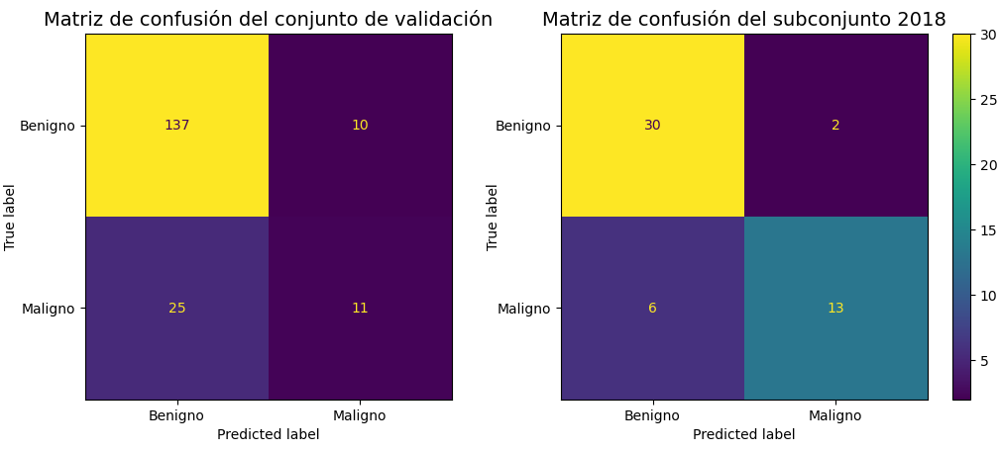
    <figcaption>
      f1_xgb:: Matrices de confusión de un XGBClassifier con una profundidad de 10.
    </figcaption>
    </figure>
  

Al igual que antes, para mejorar el desempeño del modelo se refinaron los parametros del modelo usando GridSearchCV. Luego, se ajusto el umbral de forma de maximizar el "F1-score". Los resultados obtenidos se presentan en la siguiente tabla.

  <table border="1">
      <tr>
          <th>Conjunto evaluado</th>
          <th>Precisión</th>
          <th>Recall</th>
          <th>F1-score</th>
          <th>Accuracy</th>
          <th>Kappa</th>
          <th>ROC-AUC</th>
      </tr>
      <tr>
          <td>Entrenamiento</td>
          <td>0.4143</td>
          <td>0.9317</td>
          <td>0.5736</td>
          <td>0.7245</td>
          <td>0.4116</td>
          <td>0.802</td>
      </tr>
      <tr>
          <td>Validación</td>
          <td>0.3226</td>
          <td>0.8333</td>
          <td>0.4651</td>
          <td>0.6229</td>
          <td>0.2533</td>
          <td>0.7023</td>
      </tr>
          <td>Subconjunto 2018</td>
          <td>0.5278</td>
          <td>1.0</td>
          <td>0.6909</td>
          <td>0.6667</td>
          <td>0.3966</td>
          <td>0.7343</td>
        </tr>
  </table>

<b>Tabla 5:</b> XGBClassifier parámetros refinados y umbral de decisión modificado. 

Es importante notar que, aunque hemos logrado una ligera mejora en el desempeño en el conjunto de validación, las métricas en el subconjunto correspondiente a 2018 muestran un deterioro. Al analizar las matrices de confusión, que se presentan en la figura {#xgb_tuneado}, se observa una notable reducción en la cantidad de falsos negativos. No obstante, se consideró interesante ajustar el umbral aún más para disminuir la cantidad de falsos negativos en el conjunto de validación.

  

    <figure>
      <!-- Incluir camino a la segunda imagen a mostrar -->
    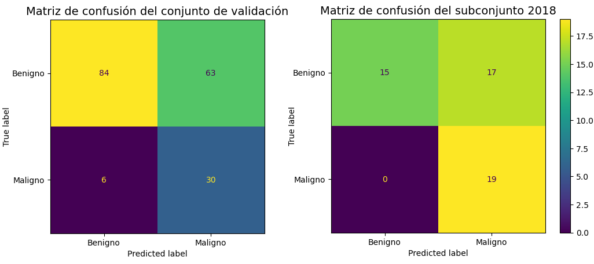
    <figcaption>
      xgb_tuneado:: Matrices de confusión de un XGBClassifier con los parametros refinados y el úmbral ajustado.
    </figcaption>
    </figure>
  

Para ajustar el umbral, se grafica "recall" y precisión para el conjunto de validación. La gráfica se ve en la figura {#recall_umbral}.

  

    <figure>
      <!-- Incluir camino a la segunda imagen a mostrar -->
    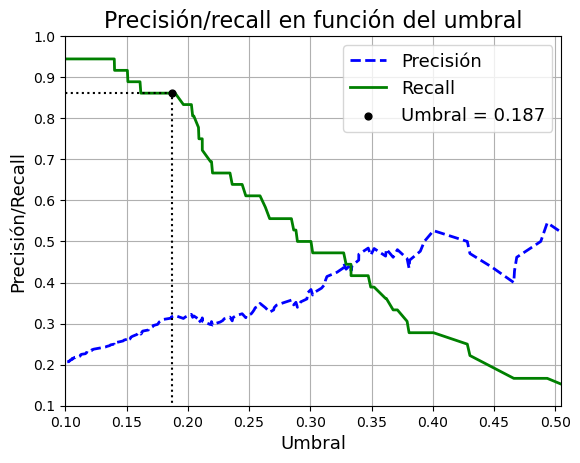
    <figcaption>
      recall_umbral:: Gráfica de precisión y "recall" en función del umbral para el conjunto de validación.
    </figcaption>
    </figure>
  

Tal como se indica en la figura, se tomo un umbral de 0.187. Con dicho valor, se obtienen las matrices de confusión vistas a continuación.

  

    <figure>
      <!-- Incluir camino a la segunda imagen a mostrar -->
    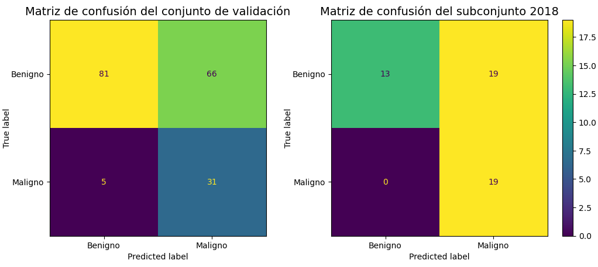
    <figcaption>
      xgb_umbral_pr:: Matrices de confusión de un XGBClassifier con el umbral ajustado viendo la grafica de precisión y "recall".
    </figcaption>
    </figure>
  

Viendo las matrices de confusión presentadas en la figura {#xgb_umbral_pr}, es claro que se mejora la cantidad de falsos negativos. Para el conjunto de validación hay solamente 5 lesiones malignas que no son detectadas, mientras que en el subconjunto de 2018 no se se escapa ninguna. Como contraparte, esta mejora viene acompañada de una alta cantidad de falsos positivos. Es más, para el subconjunto de 2018, hay más falsos positivos que verdaderos negativos, lo cual puede ser un problema si se lleva el modelo a la práctica.

### Mejoras exploradas

Un problema que se encontró en la práctica fue el asignarle cierta penalización a los falsos negativos. Es claro que se quieren minimizar, pues en un contexto medico, es menos costoso tener una falsa alarma que pasar por alto una posible lesión cancerígena. Lo ideal es que un experto le asigne los valores de penalización a cada caso. A falta de no tener un valor concreto, se exploró ajustar el umbral viendo la grafica de precisión y "recall", tal como comentó en la parte anterior. De todas formas, resultó interesante explorar otra forma de aplicar penalización a cada caso: asignar pesos a cada clase durante el entrenamiento. Para conseguir esto, es utilizo la función compute_class_weight de scikit-learn, la cual estima los pesos de cada clase usando el conjunto de entrenamiento.

Finalmente se graficó el "recall" y la precisión para el conjunto de validación, con el fin de ajustar el umbral. Viendo la figura {#recall_umbral_pesos}, se concluyó que el umbral optimo era 0.0747.

  

    <figure>
      <!-- Incluir camino a la segunda imagen a mostrar -->
    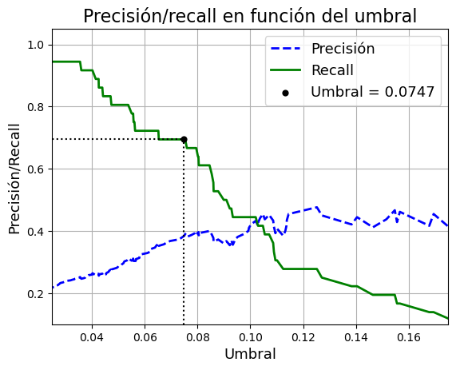
    <figcaption>
      recall_umbral_pesos:: Grafica de precisión y "recall" en función del umbral para el conjunto de validación, para el modelo con pesos para cada clase.
    </figcaption>
    </figure>
  

Los resultados se presentan en la siguiente tabla.

  <table border="1">
      <tr>
          <th>Conjunto evaluado</th>
          <th>Precisión</th>
          <th>Recall</th>
          <th>F1-score</th>
          <th>Accuracy</th>
          <th>Kappa</th>
          <th>ROC-AUC</th>
      </tr>
      <tr>
          <td>Entrenamiento</td>
          <td>0.4590</td>
          <td>0.7366</td>
          <td>0.5655</td>
          <td>0.7750</td>
          <td>0.4246</td>
          <td>0.7605</td>
      </tr>
      <tr>
          <td>Validación</td>
          <td>0.3846</td>
          <td>0.6944</td>
          <td>0.4950</td>
          <td>0.7213</td>
          <td>0.3238</td>
          <td>0.7112</td>
      </tr>
          <td>Subconjunto 2018</td>
          <td>0.6538</td>
          <td>0.8947</td>
          <td>0.7556</td>
          <td>0.7843</td>
          <td>0.5708</td>
          <td>0.8067</td>
        </tr>
  </table>

<b>Tabla 6:</b> XGBClassifier umbral modificado con gráfica de precisión y "recall" + class_weight. 

En cuanto a las matrices de confusión, las mismas se ven en la figura {#cm_pesos}. Si comparamos las mismas con las vistas en la figura {#xgb_umbral_pr}, es claro que se tiene una mayor cantidad de falsos negativos, pero a cambio no tenemos tantos falsos positivos. Es más, el desempeño en el subconjunto de 2018 parece mejorar en este último modelo, pues a pesar de no detectar 2 lesiones malignas, no se tienen tantas falsas alarmas.

  

    <figure>
      <!-- Incluir camino a la segunda imagen a mostrar -->
    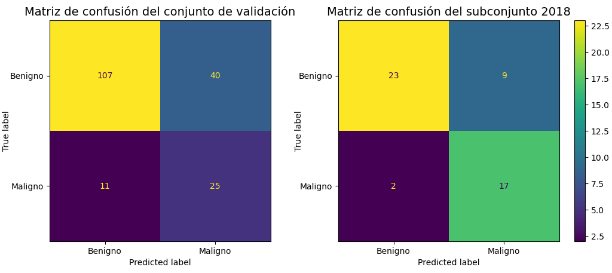
    <figcaption>
      cm_pesos:: Matrices de confusión de un XGBClassifier al cual se le pasaron los pesos de cada clase, con el umbral ajustado viendo la grafica de precisión y "recall".
    </figcaption>
    </figure>
  

<!-- IMPORTANTE: ACA ESTOY USANDO LAS CARACTERISTICAS CON LBP, ESO LO CAMBIO AL FINAL-->
<!-- IMPORTANTE: ACA ESTOY USANDO LAS CARACTERISTICAS CON LBP, ESO LO CAMBIO AL FINAL-->
<!-- IMPORTANTE: ACA ESTOY USANDO LAS CARACTERISTICAS CON LBP, ESO LO CAMBIO AL FINAL-->
<!-- IMPORTANTE: ACA ESTOY USANDO LAS CARACTERISTICAS CON LBP, ESO LO CAMBIO AL FINAL-->

## Modelo de referencia

Debido a que el desempeño del modelo depende de la calidad de la segmentación, resultó de interés entrenar un modelo con las caracteristicas extraidas usando el "ground truth" como máscara. El modelo es un XGBClassifier, al cual se le refinaron los parametros con GridSearchCV y se ajustó el umbral viendo las curvas de "recall" y precisión en función del umbral. El umbral elegido fue 0.175. Los valores de las métricas se presentan en la siguiente tabla.

  <table border="1">
      <tr>
          <th>Conjunto evaluado</th>
          <th>Precisión</th>
          <th>Recall</th>
          <th>F1-score</th>
          <th>Accuracy</th>
          <th>Kappa</th>
          <th>ROC-AUC</th>
      </tr>
      <tr>
          <td>Entrenamiento</td>
          <td>0.3701</td>
          <td>0.8829</td>
          <td>0.5216</td>
          <td>0.6780</td>
          <td>0.3353</td>
          <td>0.7550</td>
      </tr>
      <tr>
          <td>Validación</td>
          <td>0.3596</td>
          <td>0.8889</td>
          <td>0.5120</td>
          <td>0.6667</td>
          <td>0.3221</td>
          <td>0.7506</td>
      </tr>
          <td>Subconjunto 2018</td>
          <td>0.5758</td>
          <td>1.0</td>
          <td>0.7307</td>
          <td>0.7254</td>
          <td>0.4893</td>
          <td>0.7813</td>
        </tr>
  </table>

<b>Tabla 7:</b> Modelo de referencia con umbral ajustado según curva precisión - "recall". 

Las matrices de confusión se presentan en la figura {#modelo_ref_pr}.

  

    <figure>
      <!-- Incluir camino a la segunda imagen a mostrar -->
    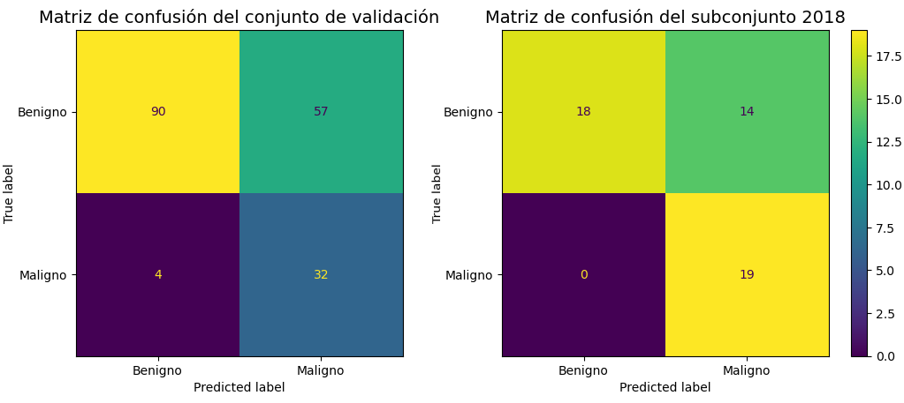
    <figcaption>
      modelo_ref_pr:: Matrices de confusión del modelo de referencia ajustando el umbral viendo la grafica de precisión y "recall".
    </figcaption>
    </figure>
  

También resultó interesante ajustar el umbral maximizando la metrica "F1-Score", esto para ver que desempeño sería posible alcanzar si se centrara en las métricas. El umbral elegido fue 0.315. Los resultados se presentan en la tabla a continuación.

  <table border="1">
      <tr>
          <th>Conjunto evaluado</th>
          <th>Precisión</th>
          <th>Recall</th>
          <th>F1-score</th>
          <th>Accuracy</th>
          <th>Kappa</th>
          <th>ROC-AUC</th>
      </tr>
      <tr>
          <td>Entrenamiento</td>
          <td>0.6404</td>
          <td>0.5561</td>
          <td>0.5953</td>
          <td>0.8497</td>
          <td>0.5035</td>
          <td>0.7393</td>
      </tr>
      <tr>
          <td>Validación</td>
          <td>0.5946</td>
          <td>0.6111</td>
          <td>0.6027</td>
          <td>0.8415</td>
          <td>0.5038</td>
          <td>0.7545</td>
      </tr>
          <td>Subconjunto 2018</td>
          <td>0.8000</td>
          <td>0.6316</td>
          <td>0.7059</td>
          <td>0.8039</td>
          <td>0.5619</td>
          <td>0.7689</td>
        </tr>
  </table>

<b>Tabla 8:</b> Modelo de referencia con umbral ajustado para maximizar "f1_score". 

Observando las métricas, es claro que se obtienen mejores valores si los comparamos con el umbral anterior. En cuanto a las matrices de confusión, las mismas se presentan en la figura {#modelo_ref_f1}.

  

    <figure>
      <!-- Incluir camino a la segunda imagen a mostrar -->
    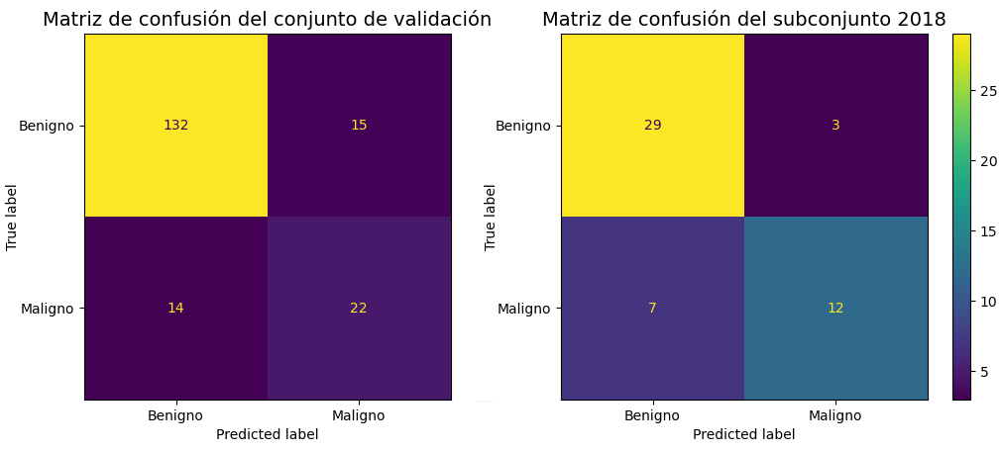
    <figcaption>
      modelo_ref_f1:: Matrices de confusión del modelo de referencia ajustando el umbral maximizando la metrica "F1-Score".
    </figcaption>
    </figure>
  

Viendo los dos modelos de referencia obtenidos, es claro que ambos tienen un desempeño mejor que los entrenados usando los datos con la segmentación implementada. De todas formas, es de interés remarcar que la diferencia no es tan grande. Especialmente si se mira la cantidad de falsos negativos. En cambio si se miran las métricas, es claro que el modelo de referencia tiene una ventaja frente a los otros modelos. 

Básicamente, esto permite ver que a pesar de no tener una segmentación perfecta, la misma es suficientemente buena como para no penalizar tanto el aprendizaje del modelo, pues a pesar de que se obtienen mejores resultados para la segmentación dada por el "ground truth", los resultados para la segmentación dada por el algoritmo son aceptables.

## Modelo final

Finalmente, se escogió el modelo que presento mejor desempeño. Debido a la pequeña cantidad de falsos negativos que presentó, se escogió el XGBoost con el umbral de 0.187. Finalmente, se evaluó su desempeño en el conjunto de prueba. Los resultados se presentan en la tabla a continuación.

  <table border="1">
      <tr>
          <th>Precisión</th>
          <th>Recall</th>
          <th>F1-score</th>
          <th>Accuracy</th>
          <th>Kappa</th>
          <th>ROC-AUC</th>
      </tr>
      <tr>
          <td>0.2402</td>
          <td>0.7692</td>
          <td>0.3661</td>
          <td>0.4683</td>
          <td>0.0889</td>
          <td>0.5812</td>
      </tr>
  </table>

<b>Tabla 9:</b> Modelo final - conjunto de prueba. 

En cuanto a la matriz de confusión, la misma se ve en la figura {#cm_test}.

  

    <figure>
      <!-- Incluir camino a la segunda imagen a mostrar -->
    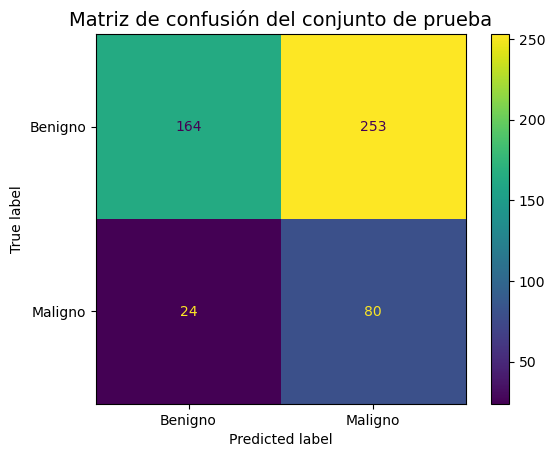
    <figcaption>
      cm_test:: Matriz de confusión del modelo final en el conjunto de test.
    </figcaption>
    </figure>
  

Observando las métricas en la tabla, era de esperar que las mismas no sean las mejores, pues al momento de escoger el modelo se ha priorizado disminuir la cantidad de falsos negativos. En cuanto a la cantidad de los mismos, parece razonable, pues solamente no se ha logrado detectar el 23% de melanomas. Es vital recordar que hay una cierta cantidad de segmentaciones que son muy pobres, por lo que extracción características correspondiente pierde sentido, lo que significa que hay una cierta cantidad de lesiones que en principio no serán clasificadas de manera certera.