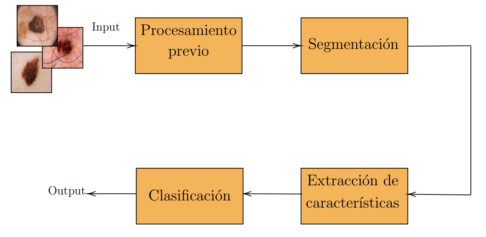

Title: Introducción
Date: 2023-07-03
Category: Page
Ordinal: 001

# PROYECTO - LESIONES DE PIEL

Las lesiones de la piel, como los lunares, son un tema de gran importancia en el campo de la dermatología. Detectar y diagnosticar correctamente estas lesiones es crucial para identificar posibles casos de melanoma y tomar las medidas adecuadas en términos de tratamiento y seguimiento.

En la presente página, se aborda el problema de la detección de melanoma a través de la aplicación de técnicas de segmentación y extracción de características en imágenes de lesiones de piel. Para llevar a cabo este estudio, se dispone de una subbase de imágenes provenientes del concurso ISIC-2017 (International Skin Imaging Collaboration), que proporciona una valiosa colección de casos clínicos.

El proceso de detección de melanoma realizado por los profesionales de la dermatología se basa en varios métodos, entre los que se destacan la regla ABCD y la de los 7 checklists. Estas reglas son herramientas de evaluación que permiten examinar las características de las lesiones cutáneas y establecer indicios de malignidad. La regla ABCD, ampliamente utilizada, se basa en la observación de cuatro criterios principales: Asimetría, Bordes irregulares, Coloración variada y Diámetro superior a 6 mm. Estos indicadores proporcionan una guía inicial para identificar lesiones sospechosas y diferenciarlas de las benignas. Por otro lado, la regla de los 7 checklists se enfoca en la detección temprana del melanoma a través de la evaluación de siete características clave: cambios de tamaño, forma, color, simetría, bordes, inflamación y sensación. La presencia o ausencia de alteraciones en cada uno de estos aspectos proporciona información valiosa para el diagnóstico temprano.

En este contexto, el presente proyecto se divide en dos grandes partes. La primera consiste en la segmentación de las lesiones de piel, es decir, la identificación y delimitación precisa de la región de interés en las imágenes. Esto permitirá un análisis más enfocado y preciso de las características de las lesiones. La segunda parte del proyecto implica la extracción de características y la creación de un modelo de clasificación. Una vez que se ha obtenido la segmentación adecuada, se extraen características relevantes. Estas características se utilizan para desarrollar un modelo de clasificación capaz de distinguir entre lesiones benignas y casos potenciales de melanoma. A continuación en la Figura {#fig_daig_bloques_pap} se presenta un diagrama de bloques el cual describe el proceso punta a punta para llegar a la clasificación.

<figure>
  <!--Incluir camino a la imagen a mostrar-->
  
  <figcaption>
  fig_daig_bloques_pap :: Diagrama de bloques punta a punta.
  </figcaption>
</figure>

Resumiendo, este proyecto busca aplicar técnicas de segmentación y extracción de características en imágenes de lesiones de piel con el fin de desarrollar un modelo de clasificación que pueda contribuir en la detección de melanoma, combinando conocimientos de herramientas de procesamiento de imágenes y aprendizaje automático.

Para la realización de este proyecto, se utilizaron varias fuentes como referencia. Las mismas se presentan a continuación.

- <a href="https://eva.fing.edu.uy/pluginfile.php/63378/mod_resource/content/2/capdehourat2011melanoma.pdf"> Capdehourat, G., Corez, A., Bazzano, A., Alonso, R., & Musé, P. Toward a combined tool to assist dermatologists in melanoma detection from dermoscopic images of pigmented skin lesions. </a>
- <a href="https://link-springer-com.proxy.timbo.org.uy/article/10.1007/s11042-022-13046-0"> Sharafudeen, M., & Vinod Chandra, S. S. Detecting skin lesions fusing handcrafted features in image network ensembles. </a>
- <a href="https://github.com/anindox8/Multi-Color-Space-Features-for-Dermatoscopy-Classification"> Usuario de GitHub "anindox8". Color/Texture Features with Support Vector Machine and Random Forest for Disease Classification of Skin Lesions. </a>
