Title: Métodos
Date: 2023-07-03
Category: Page
Ordinal: 002

A continuación, se procederá a explicar cada bloque presentado en el diagrama de bloques, el cual se encuentra en la sección de introducción. Cada bloque será descrito detalladamente y se proporcionarán diversas imágenes intermedias del proceso con el objetivo de lograr una comprensión profunda de cada paso.

## Procesamiento previo

En una etapa crucial del proceso, se lleva a cabo la segmentación de las lesiones. Sin embargo, se enfrenta un desafío significativo en este tipo de imágenes: la presencia de pelos. La presencia de pelos puede tener un impacto negativo en el resultado de la segmentación de las lesiones de piel, para abordar este problema de manera efectiva, se propone la implementación del algoritmo Dull Razor.

El algoritmo de "Dull Razor" es una técnica de preprocesamiento de imágenes que se utiliza para tratar el problema de la presencia de pelos o imperfecciones en una imagen antes de realizar ciertas operaciones, como la segmentación de lesiones en la piel. Dado que el código no es extenso, a continuación se muestra el algoritmo de manera concisa.

``` python
def dull_razor(I):
    #Paso a gris la imagen original
    grayScale = cv2.cvtColor(I, cv2.COLOR_RGB2GRAY )
    
    #Black hat filter
    kernel = cv2.getStructuringElement(1,(36,36)) 
    blackhat = cv2.morphologyEx(grayScale, cv2.MORPH_BLACKHAT, kernel)
    
    #Blur gaussiano
    bhg= cv2.GaussianBlur(blackhat,(3,3),cv2.BORDER_DEFAULT)
    
    #Binary thresholding (MASK)
    mask = cv2.threshold(bhg,10,255,cv2.THRESH_BINARY)[1]
    
    #Remplazar píxeles de mask
    dst = cv2.inpaint(I,mask,6,cv2.INPAINT_TELEA)   

    return dst
```

1.  El primer paso es convertir la imagen original I de formato RGB (rojo, verde y azul) a escala de grises. La conversión a escala de grises se realiza para facilitar el procesamiento posterior, ya que las operaciones posteriores se pueden aplicar de manera más eficiente en imágenes de un solo canal (escala de grises).

2. Se crea un kernel que se utilizará para aplicar el filtro "Black Hat". 

3. Luego, se aplica el filtro "Black Hat" a la imagen en escala de grises previamente obtenida. El filtro "Black Hat" es una operación de morfología que destaca las regiones oscuras pequeñas y puede ayudar a resaltar las imperfecciones o pelos en la imagen.

4. Se aplica un blur gaussiano a la imagen resultante después de aplicar el filtro "Black Hat". Esto ayuda a suavizar la imagen y eliminar pequeños detalles no deseados.

5. Finalmente, se utiliza la función <strong>cv2.inpaint()</strong> para rellenar las regiones marcadas por la máscara en la imagen original I. La función utiliza el algoritmo "Inpainting" para reemplazar los píxeles de las regiones con pelos o imperfecciones con píxeles coherentes basados en los píxeles del entorno. El resultado es una imagen preprocesada que ha eliminado los pelos y otras imperfecciones, preparándola para realizar la segmentación.

A continuación se muestran un ejemplo con la imágen ISIC_0011386 del conjunto, desde la imagen inicialmente hasta luego que sale del filtro, mostrando todos los pasos intermedios. 

En primer lugar, partimos de la imagen original, la cual muestra claramente la presencia de pelos. Además, se pueden observar unas líneas paralelas negras, utilizadas por los profesionales para medir el tamaño de la lesión. Estas líneas son también interpretadas como pelos por el algoritmo debido a su estructura similar.

<div style="display: flex; justify-content: center;">
  <figure>
    <!-- Incluir camino a la imagen a mostrar -->
    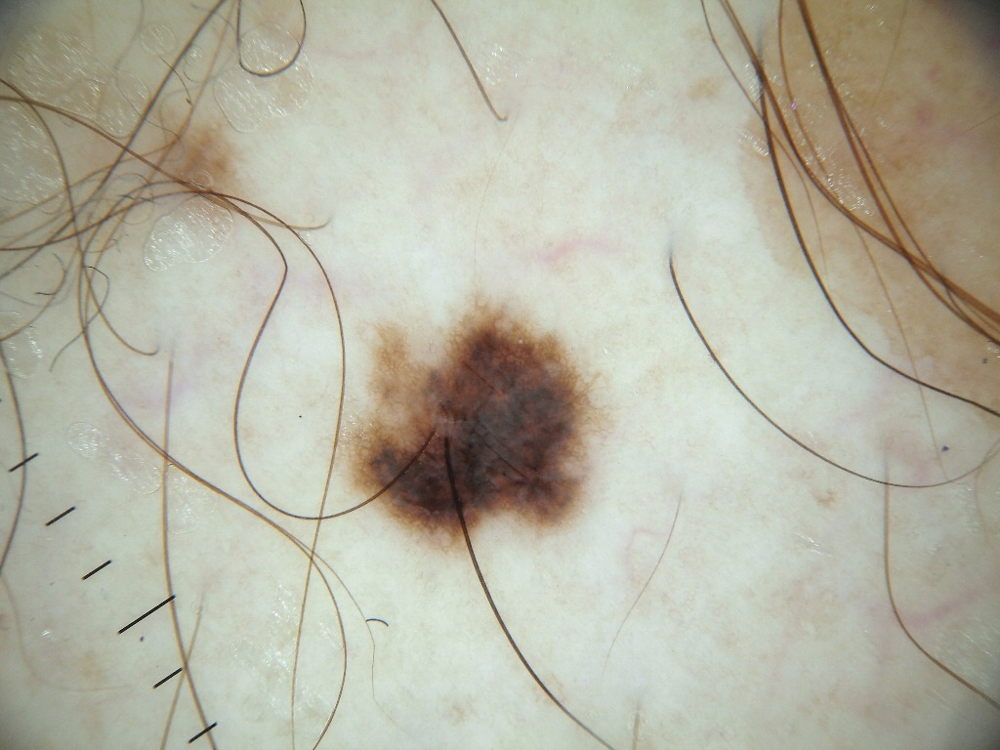
    <figcaption>
      fig_dull_razor_0 :: Imagen inicial.
    </figcaption>
  </figure>
</div>

Después de llevar a cabo la conversión de la imagen a escala de grises, se procede a aplicar el filtro "Black Hat", que como se explicó anteriormente, es una operación de procesamiento de imágenes que tiene como objetivo detectar y resaltar las áreas oscuras y pequeñas en la imagen.

<div style="display: flex; justify-content: center;">
  <figure>
    <!-- Incluir camino a la imagen a mostrar -->
    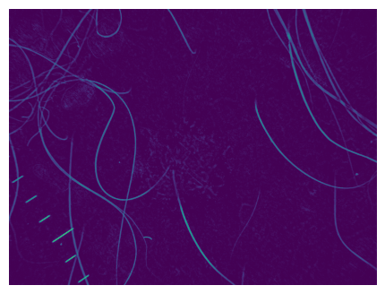
    <figcaption>
      fig_dull_razor_bh :: Imagen inicial + Black Hat Filter.
    </figcaption>
  </figure>
</div>

Después de aplicar el filtro "Black Hat", se procede a aplicar un filtro de desenfoque gaussiano. Esta segunda etapa busca suavizar la imagen y reducir el ruido presente en el resultado obtenido con el filtro "Black Hat" y finalmente se crea la siguiente máscara.

<div style="display: flex; justify-content: center;">
  <figure>
    <!-- Incluir camino a la imagen a mostrar -->
    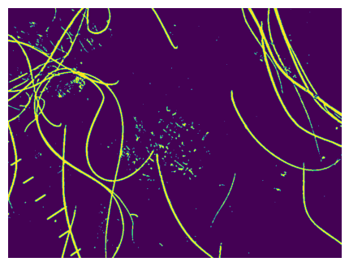
    <figcaption>
      fig_dull_razor_mask :: Máscara final
    </figcaption>
  </figure>
</div>

Una vez que se ha obtenido la máscara binaria, se inicia el proceso de inpainting, que permite rellenar todos los píxeles marcados en la máscara utilizando información de los píxeles del entorno en la imagen original.

<div style="display: flex; justify-content: center;">
  <figure>
    <!-- Incluir camino a la imagen a mostrar -->
    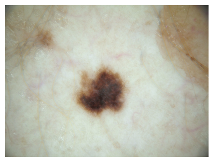
    <figcaption>
      fig_dull_razor_output:: Salida del filtro "Dull Razor".
    </figcaption>
  </figure>
</div>

Es posible observar una exitosa eliminación tanto de los pelos presentes en la imagen como de las líneas negras utilizadas para medir el tamaño de la lesión, mencionadas previamente. A continuación, se presentan ejemplos adicionales de la entrada y la salida del filtro aplicado a otras imágenes.

<div style="display: flex; justify-content: center;">
  <figure>
    <!-- Incluir camino a la imagen a mostrar -->
    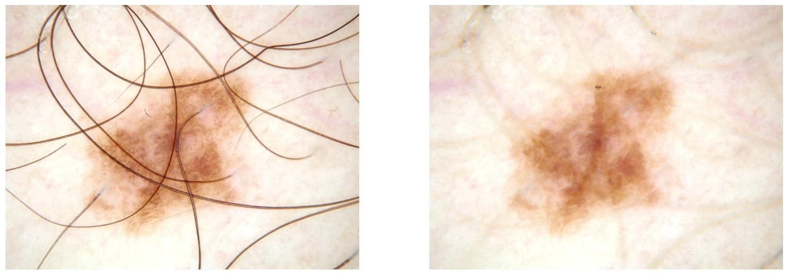
    <figcaption>
      fig_dull_razor_output_1:: Entrada y salida del filtro "Dull Razor" - Ejemplo 1.
    </figcaption>
  </figure>
</div>

<div style="display: flex; justify-content: center;">
  <figure>
    <!-- Incluir camino a la imagen a mostrar -->
    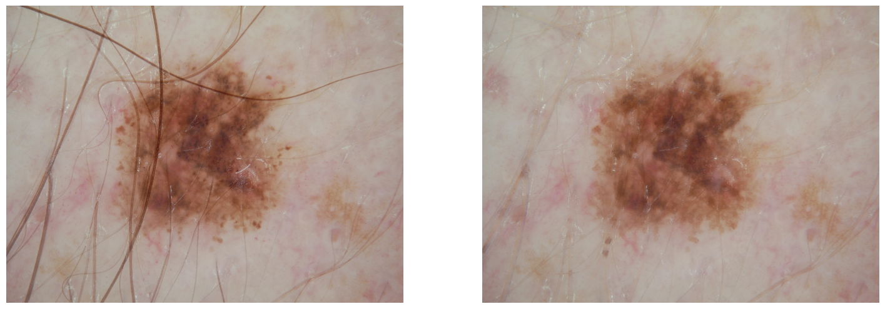
    <figcaption>
      fig_dull_razor_output_2:: Entrada y salida del filtro "Dull Razor" - Ejemplo 2.
    </figcaption>
  </figure>
</div>

## Segmentación
Para la parte de segmentación, se decide utilizar una segmentación por umbralización. Más especificamente, el algorítmo de Otsu.

El algoritmo de Otsu es una técnica de umbralización automática. Su objetivo es determinar un valor de umbral óptimo para dividir una imagen en dos clases: píxeles de primer plano (Foreground) y píxeles de fondo (Background) de manera que se minimice la 'intra-class variance' de las clases. El algorítmo se basa en el histograma de la imagen, iterando sobre posibles umbrales y calculando la varianza entre clases, la cual se puede pensar de la siguiente manera: para poder evaluar que tan bueno es un umbral, se calcula una medida de dispersión para saber que tan dispersas quedan las regiones con el threshold dado, la 'intra-class variance' es una métrica final que combina la dispersión en cada clase multiplicada por el peso de la misma.

<div style="display: flex; justify-content: center;">
  <figure>
    <!-- Incluir camino a la imagen a mostrar -->
    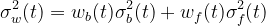
  </figure>
</div>

Los pesos se calculan de la siguiente manera, suponiendo que el histograma tiene L bins.

<div class="row" style = "display: flex; justify-content: center;">
  <div class="column">
    <figure>
      <!-- Incluir camino a la primera imagen a mostrar -->
      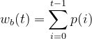
    </figure>
  </div>
  
  <div class="column">
    <figure>
      <!-- Incluir camino a la segunda imagen a mostrar -->
      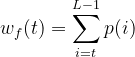
    </figure>
  </div>
</div>

Una vez, se computan todos los posibles valores de la 'intra-calss variance',  se toma el óptimo y se procede a binarizar la imagen con el umbral correspondiente. Es importante no confundir 'intra-class variance' con 'inter-class variance', ya que cuando se trata de dos clases (como en este caso), minimizar la 'intra-class variance' corresponde a maximizar la 'inter-class variance'.

El método se puede resumir en los siguientes pasos.

1. Convertir la imagen a escala de grises.

2. Calcular histograma.

3. Calcular la varianza intra-clases para todos los posibles umbrales.

4. Determinar el umbral óptimo.

5. Binarizar la imágen con el umbral óptimo.

Desafortunadamente, debido a la gran variedad de imágenes, un umbral de Otsu simple no es suficiente para lograr una segmentación precisa en los conjuntos de imágenes. La segmentación final requiere lógica adicional para identificar y separar correctamente la lesión del resto de la imagen. A continuación, en la figura {#diagrama_sgm}, se muestra un diagrama explicativo que ilustra la segmentación final a la que se ha llegado.

<div style="display: flex; justify-content: center;">
  <figure>
    <!-- Incluir camino a la primera imagen a mostrar -->
    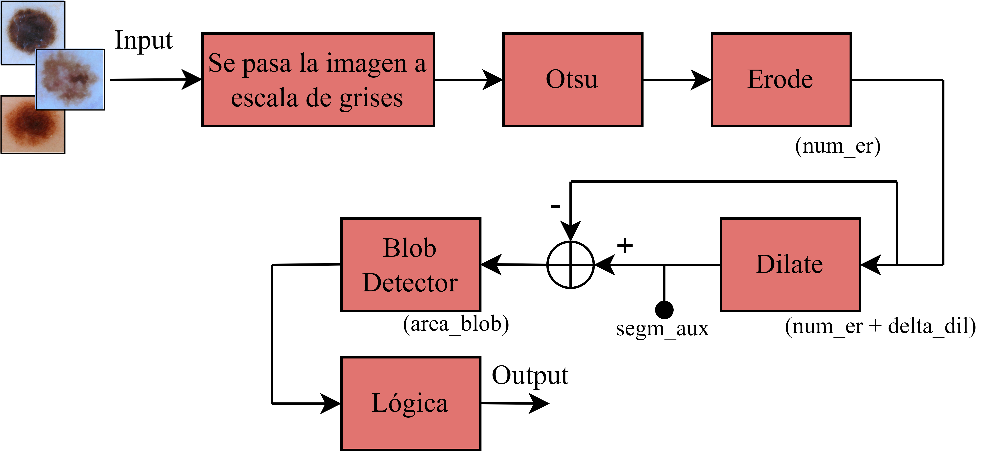
    <figcaption>
      diagrama_sgm :: Diagrama del algoritmo de segmentación.
    </figcaption>
  </figure>
</div> 

En el diagrama de bloques del algoritmo, se incluye un bloque llamado <em>Lógica</em>, el cual se presenta en la figura {#diagrama_logico}.

<div style="display: flex; justify-content: center;">
  <figure>
    <!-- Incluir camino a la segunda imagen a mostrar -->
    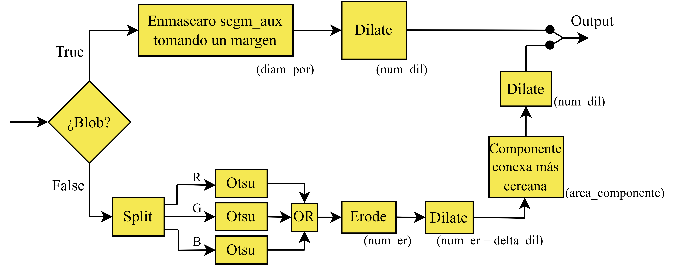
    <figcaption>
      diagrama_logico :: Diagrama del bloque logico presente en el algoritmo de segmentación.
    </figcaption>
  </figure>
</div>

Para demostrar de manera grafica como trabaja el algoritmo, se presentaran las salidas más relevantes cuando se introduce la imagen <em>ISIC_0000002</em>, la cual se presenta en la siguiente figura junto a su segmentación "ground_truth".

<div style="display: flex; justify-content: center;">
  <figure>
    <!-- Incluir camino a la segunda imagen a mostrar -->
    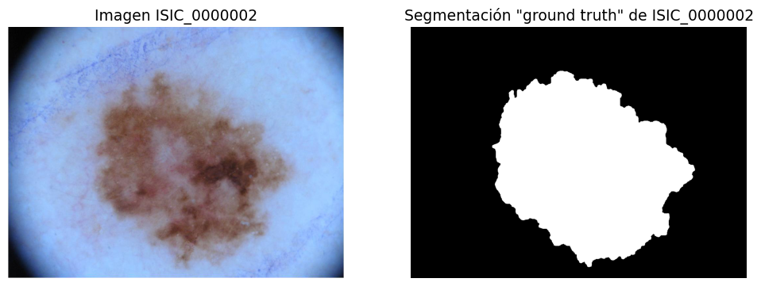
    <figcaption>
      true_gt :: Imagen ISIC_0000002 y su segmentación "groud truth".
    </figcaption>
  </figure>
</div>

Tal como se ve en la figura {#diagrama_sgm}, el algoritmo comienza segmentando la imagen con el umbral de Otsu. Luego, se erosiona la imagen <em>num_er</em> veces, con el objetivo de eliminar pequeñas manchas en la segmentación que no pertenecen a la lesión. Después, se dilata la imagen <em>num_er + delta_er</em> veces, de forma de recuperar la segmentación erosionada en el bloque anterior. Esta imagen se guarda en una variable llamada <em>segm_aux</em>. Básicamente, el proceso se resume en lo visto en la siguiente figura.

<div style="display: flex; justify-content: center;">
  <figure>
    <!-- Incluir camino a la segunda imagen a mostrar -->
    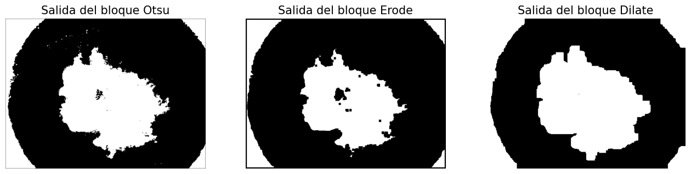
    <figcaption>
      primer_paso :: Salida de los bloques Otsu, Erode y Dilate para la imagen Otsu.
    </figcaption>
  </figure>
</div>

Luego, se realiza la resta entre la salida del bloque <em>Erode</em> y <em>Dilate</em>, lo que resulta en el contorno de la lesión. Dicho contorno es la entrada del bloque <em>Blob Detector</em>, el cual busca formas similares a un circulo, las cuales tengan un area mayor o igual a <em>area_blob</em>. Si encuentra dicha forma, estima su centro y diametro, y marca el "blob" con un circulo azul. Debido a que la mayoria de las lesiones tienen una forma circular (o similar), se busca que el bloque encuentre la lesión y de una estimación de su ubicación en la imagen. El bloque <em>Blob Detector</em> funciona de mejor forma si le pasamos un contorno y no una forma solida, es por esto que la entrada es la resta entre <em>Erode</em> y <em>Dilate</em>. A continuación, en la figura {#segundo_paso}, se muestra un ejemplo donde se detecta un "blob" de forma correcta.


<div style="display: flex; justify-content: center;">
  <figure>
    <!-- Incluir camino a la segunda imagen a mostrar -->
    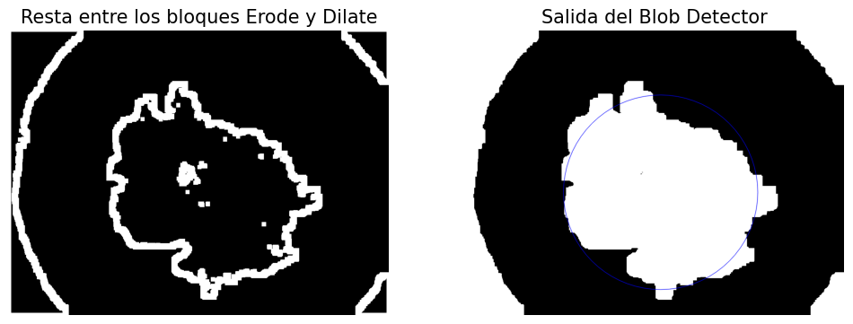
    <figcaption>
      segundo_paso :: Salida de la resta entre Otsu y Erode, y el resultado de Blob Detector.
    </figcaption>
  </figure>
</div>


En este caso, el bloque <em>Blob Detector</em> logra detectar de manera exitosa la lesión como un "blob". Esto no siempre es así, pues en algunos casos el bloque no logra detectar a la lesión como un "blob". Es por esto que se introduce el bloque <em>Lógica</em>, el cual es basicamente un "if", preguntandose si se detectó o no un "blob".

En caso de detectarse un "blob", se crea una máscara circular centrada en el centro estimado por el <em>Blob Detector</em>. En cuanto al diámetro, se toma el obtenido por <em>Blob Detector</em> y se lo multiplica por <em>diam_por</em>, el cual será mayor a 1, esto para tomarse un diámetro mayor al estimado, pues se notó que en general el diámetro estimado no contenia toda la lesión. Con dicha máscara circular, se enmascara la imagen guardada en la variable <em>segm_aux</em>, esto con el objetivo de eliminar los bordes de la imagen de la segmentación. Finalmente, se dilata el resultado <em>num_dil</em> veces, esto para tomar un margen mayor en caso de haber cortado la lesión con la máscara. El resultado es la salida del algoritmo. Este proceso se presenta en la figura {#tercer_paso_true}.

<div style="display: flex; justify-content: center;">
  <figure>
    <!-- Incluir camino a la segunda imagen a mostrar -->
    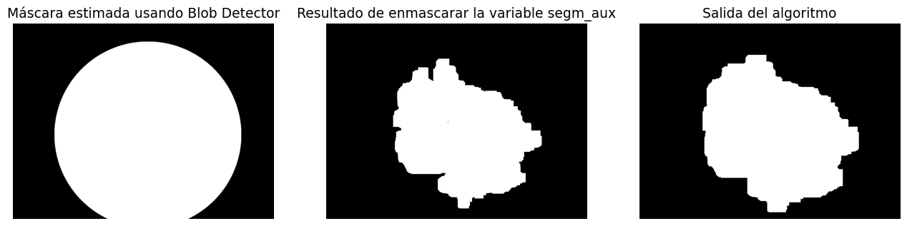
    <figcaption>
      tercer_paso_true :: Mascara estimada por Blob Detector, imagen enmascarada y salida del algoritmo.
    </figcaption>
  </figure>
</div>

En la figura {#salida_true} se compara la segmentación dada por el "ground truth" con la salida del algoritmo. Observar que el resultado obtenido por el algoritmo es bueno.

<div style="display: flex; justify-content: center;">
  <figure>
    <!-- Incluir camino a la segunda imagen a mostrar -->
    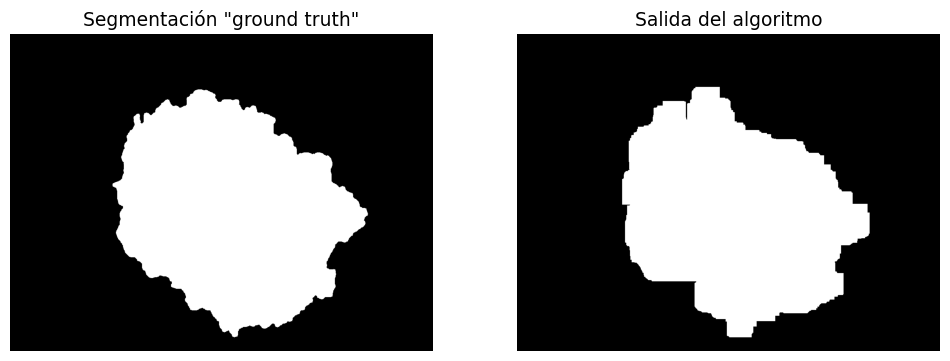
    <figcaption>
      salida_true :: Comparación entre la salida del algoritmo y el "groun truth", en el caso que se detecto un "blob".
    </figcaption>
  </figure>
</div>

Tal como se aclaró previamente, hay imágenes en las cuales no se detecto un blob, un ejemplo es la imagen <em>ISIC_0013553</em> vista en la figura {#false_gt}. A continuación se explicara el procedimiento en caso de no detectar un "blob".

<div style="display: flex; justify-content: center;">
  <figure>
    <!-- Incluir camino a la segunda imagen a mostrar -->
    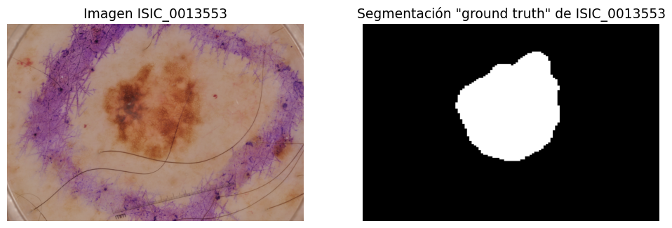
    <figcaption>
      false_gt :: Imagen ISIC_0013553 y su segmentación "groud truth".
    </figcaption>
  </figure>
</div>

Para comenzar, se realiza la segmentación aplicando la segmentación con el umbral de Otsu en cada canal y se realiza la operación logica "OR" entre las tres segmentaciones obtenidas. En la practica, se notó que en general las imagenes a las cuales no se les detectaba un "blob" era debido a que la segmentación de la imagen pasada a escala de grises no lograba capturar de buena forma la lesión. Entonces, a pesar de introducir una cantidad mayor de ruido en la segmentación, al tomar un "OR" entre los tres canales nos aseguramos de capturar la mayor cantidad de lesión posible. Luego, al igual que al comienzo del algoritmo, se dilata y erosiona la imagen con el fin de eliminar el ruido por segmentar con los tres canales. Finalmente, con el objetivo de capturar solamente la lesión en la segmentación, se toma la componente conexa mas cercana al centro, la cual tiene área mayor o igual a <em>area_componente</em>. Para terminar, se dilata el resultado <em>num_dil</em> veces, esto en caso de no haber capturado en su completitud a la lesión.

<div style="display: flex; justify-content: center;">
  <figure>
    <!-- Incluir camino a la segunda imagen a mostrar -->
    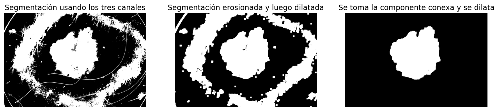
    <figcaption>
      tercer_paso_false :: Resultado de segmentar los tres canales, erosionar y dilatar y finalmente tomar la componente conexa.
    </figcaption>
  </figure>
</div>

En la figura {#salida_false} se compara la segmentación dada por el "ground truth" con la salida del algoritmo, observar que ambas segmentaciones son muy similares.

<div style="display: flex; justify-content: center;">
  <figure>
    <!-- Incluir camino a la segunda imagen a mostrar -->
    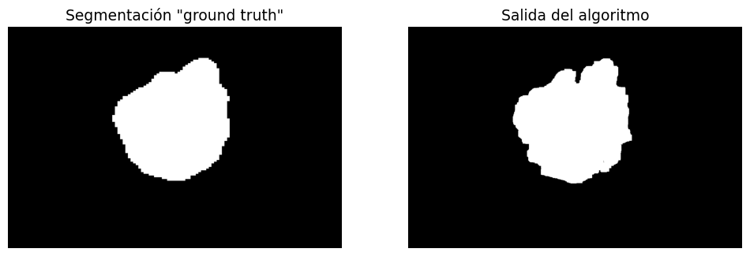
    <figcaption>
      salida_false :: Comparación entre la salida del algoritmo y el "ground truth", en el caso que no se detecto un "blob".
    </figcaption>
  </figure>
</div>

## Extracción de características

Después de aplicar las máscaras, las imágenes resultantes muestran únicamente la presencia de la lesión. En este punto, el siguiente paso es extraer características importantes de estas imágenes con el propósito de utilizarlas como datos para entrenar un clasificador. Debido a la gran variedad de imágenes (de muchos tamaños distintos), se decidió extraer únicamente características de color y textura. 

Para extraer las características de las imágenes, se emplearon tanto los canales en RGB como en HSV. Además, se aplicó una función llamada "color_constant()", la cual multiplica los canales de la imagen por una proporción calculada internamente y los normaliza. Al aplicar esta función a las imágenes RGB y HSV, se obtienen dos nuevas imágenes: una versión corregida en color RGB_cc y otra en HSV_cc. Además, se empleó otra función llamada "correct_image()", con el propósito de corregir los colores de una imagen. Esta corrección se realiza mediante una transformación diagonal que se basa en una estimación de la iluminación proporcionada como entrada a la función, resultando en dos imágenes adicionales: RGB_mx y HSV_mx.

De cada una de estas 6 nuevas imágenes (RGB, HSV, RGB_cc, HSV_cc, RGB_mx, HSV_mx) se extraen las características de "mean", "std" y "skew" de cada canal, obteniendo una cantidad de 54 características.

Luego se obtienen características utilizando la matriz de coocurrencia, una herramienta que describe la distribución espacial de las intensidades de píxeles en una imagen. De esta matriz, se extrajeron las siguientes características: contraste, disimilitud, homogeneidad, energía y correlación, para cada uno de los tres canales de la imagen de entrada. Estas características son útiles para representar y caracterizar patrones y texturas presentes en la imagen. En este caso se aplicó este método solo a las imágenes en RGB y HSV, obteniendo una cantidad de 30 características. 

Un siguiente paso es usar la función "local_binary_pattern" de la librería skimage (scikit-image) se utiliza para calcular el Patrón Binario Local de una imagen en escala de grises. El LBP es una técnica de descripción de texturas que codifica la relación de intensidades entre un píxel central y sus píxeles vecinos en una vecindad circular. Esta función se usa dentro de otra función desarrollada llamada 'LBP', en la cual se aplica "local_binary_pattern" a cada canal. Nuevamente, la función "LBP" sea plica a las imágenes en RGB y HSV, obteniendo una cantidad de 6 características nuevas.

Por otro lado, también se extraen características adicionales de suavidad, uniformidad y entropía de las imágenes. Las mismas se extraen de cada canal de la imagen de entrada y la función fue aplicada a las imágenes RGB y HSV, obteniendose una cantidad de 18 características.

Finalmente con la función "melanoma_color_markers()" se extraen 4 nuevas características para detectar la presencia de colores negro, blanco, marron claro y oscuro.

En resumen, se extrajeron un conjunto completo de 112 características que engloban tanto aspectos de color como de textura, las cuales serán empleadas para la tarea detectar la presencia de melanoma en las lesiones.

## Clasificación

Respecto a la clasificación, se realiza una comparación entre dos modelos distintos. Por un lado, se emplea un RandomForestClassifier de la librería scikit-learn, y por otro lado, se utiliza un XGBoostClassifier (Extreme Gradient Boosting) de la librería xgboost. Los modelos basados en árboles, como los elegidos, son preferidos debido a su capacidad para manejar datos sin requerir una preparación exhaustiva. Estos algoritmos pueden trabajar directamente con características en su formato original, lo que simplifica el flujo de trabajo y reduce el tiempo de procesamiento. 